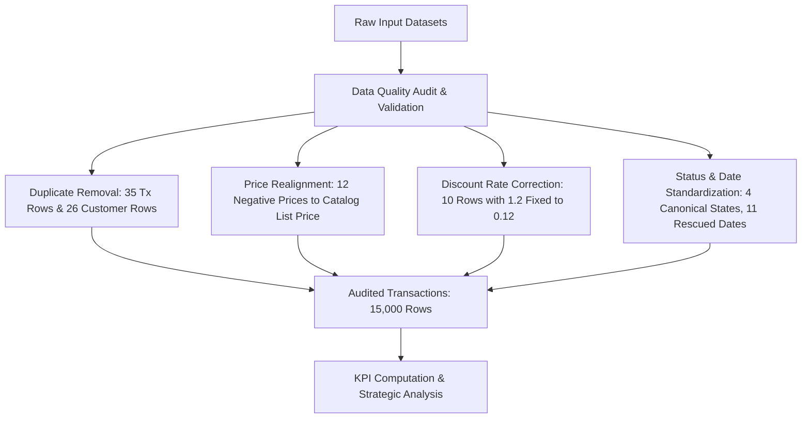
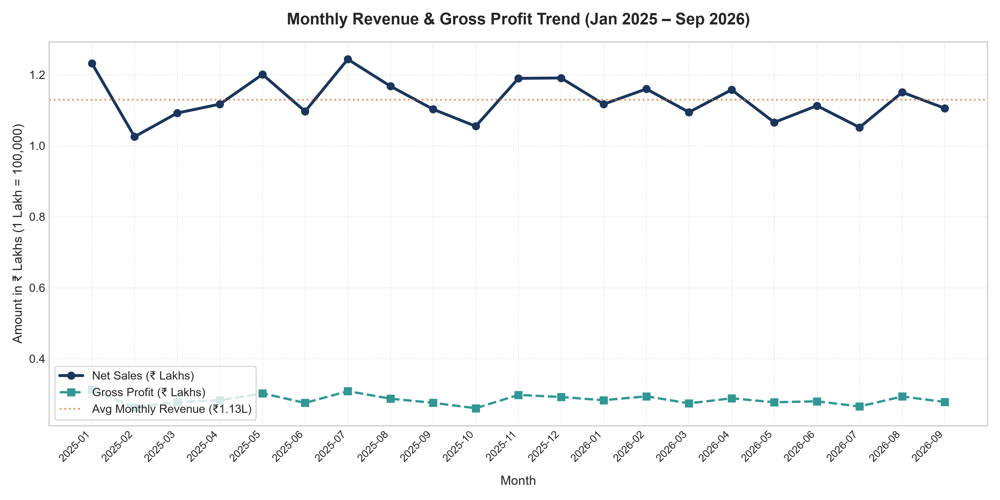
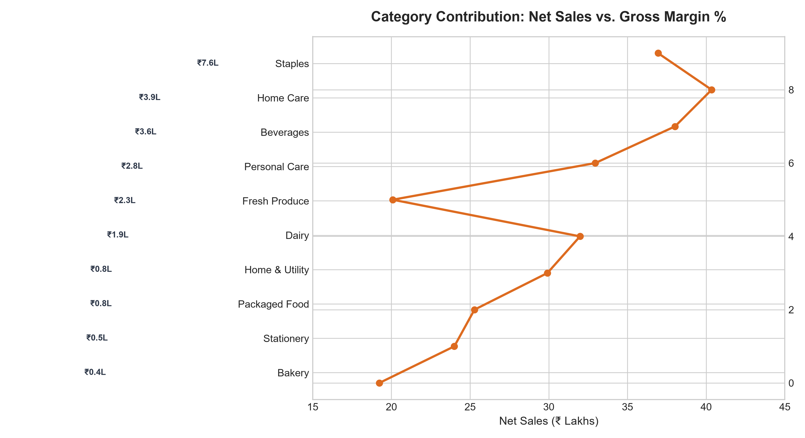
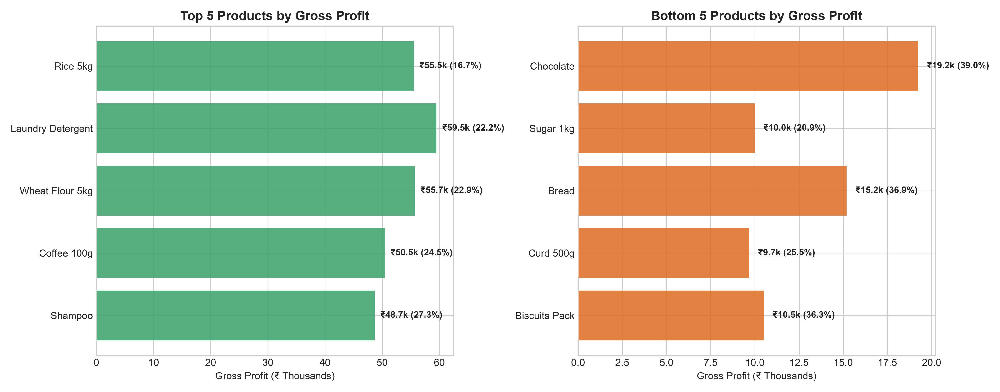
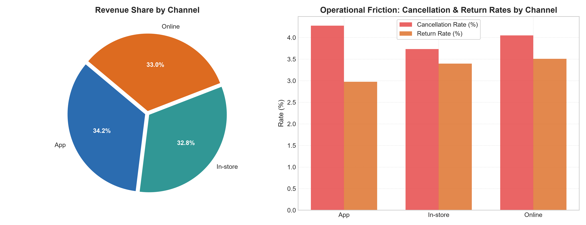
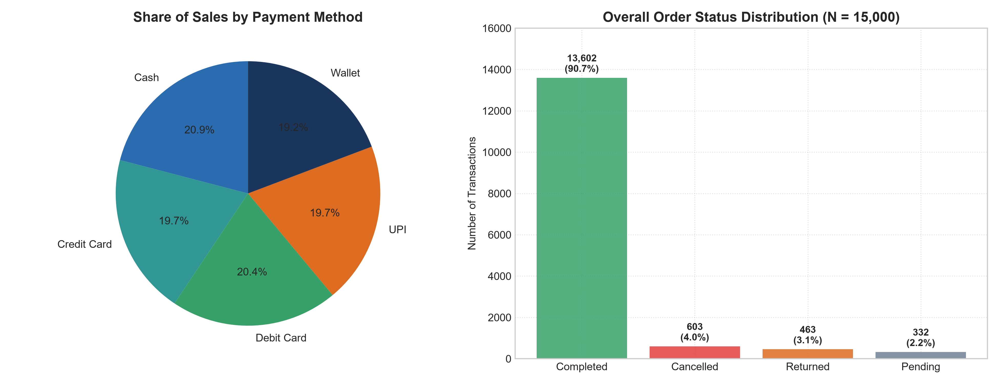
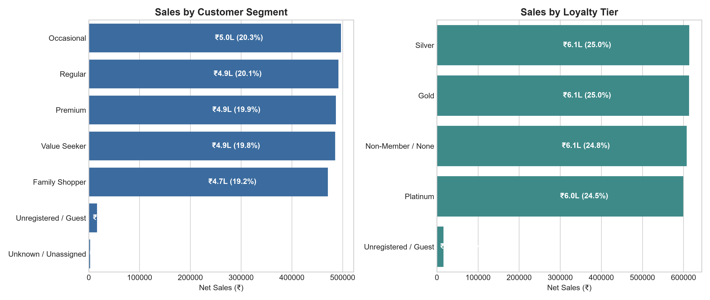
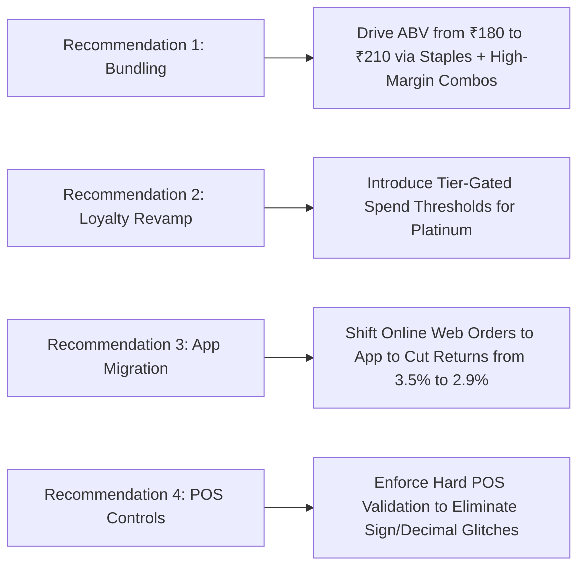

# DMart Retail Analytics — Preliminary Round Assignment Report
**Candidate: Abhighna Mopidevi | Assessment Submission | Data Analyst Position**  
*Evaluation Period: January 1, 2025 – October 19, 2026*  
*Prepared for: Corporate Chanakya Services Pvt Ltd (HR / Technical Assessment Team)*  

---

## 1. Executive Summary & Core KPIs

This assessment evaluates retail transaction performance, customer segmentation, and product unit economics across synthetic DMart operational datasets. The raw datasets were subjected to a data-cleaning and audit protocol to rectify deliberately introduced quality issues (including duplicate records, negative unit prices, decimal errors in discount rates, impossible dates, and demographic anomalies).

### Key Performance Indicators (KPIs) Summary

| Category | Key Performance Indicator (KPI) | Calculated Value | Formula / Derivation |
| :--- | :--- | :--- | :--- |
| **Revenue & Sales** | **Gross Sales** | **₹25,88,674.00** | $\sum (\text{Quantity} \times \text{List Price})$ across completed orders |
| | **Total Discounts** | **₹1,38,047.08** | $\sum (\text{Gross Sales} \times \text{Discount Rate})$ |
| | **Effective Discount Rate** | **5.33%** | $\text{Total Discounts} / \text{Gross Sales}$ |
| | **Realized Net Sales (Revenue)** | **₹24,50,626.92** | $\text{Gross Sales} - \text{Total Discounts}$ |
| **Profitability** | **Cost of Goods Sold (COGS)** | **₹18,34,429.00** | $\sum (\text{Quantity} \times \text{Unit Cost})$ from Product Lookup |
| | **Estimated Gross Profit** | **₹6,16,197.92** | $\text{Net Sales} - \text{COGS}$ |
| | **Gross Profit Margin (%)** | **25.14%** | $(\text{Gross Profit} / \text{Net Sales}) \times 100$ |
| **Order Economics** | **Completed Orders / Transactions** | **13,602** | Total orders with canonical status `'Completed'` |
| | **Total Units Sold** | **20,513** | $\sum \text{Quantity}$ across completed orders |
| | **Average Basket Value (ABV)** | **₹180.17** | $\text{Net Sales} / \text{Completed Orders}$ |
| | **Average Selling Price (ASP)** | **₹119.47** | $\text{Net Sales} / \text{Total Units Sold}$ |
| | **Units Per Transaction (UPT)** | **1.51** | $\text{Total Units Sold} / \text{Completed Orders}$ |
| **Customer Metrics** | **Total Audited Customer Base** | **3,200** | Unique valid customer profiles (deduplicated) |
| | **Active Transacting Customers** | **3,150** | Distinct customers with $\ge 1$ completed transaction |
| | **Customer Activity Rate** | **98.44%** | $\text{Active Customers} / \text{Total Customers}$ |
| | **Average Revenue Per User (ARPU)** | **₹777.98** | $\text{Net Sales} / \text{Active Transacting Customers}$ |
| **Operations & Quality** | **Total Pipeline Orders** | **15,000** | Deduplicated order records |
| | **Order Completion Rate** | **90.68%** | $\text{Completed Orders} / \text{Total Orders}$ |
| | **Order Cancellation Rate** | **4.02%** | 603 cancelled orders (₹1,13,882.41 lost value) |
| | **Order Return Rate** | **3.29%** | 463 returned orders (₹82,261.16 reversed revenue) |
| | **Pending Order Rate** | **2.21%** | 332 pending orders |

---

## 2. Data Validation & Quality Audit

The raw data was provided in three files: `Dmart_Customer_Master_Raw.csv`, `Dmart_Consumer_Transactions_Raw.csv`, and `Dmart_Product_Lookup.csv`. A thorough audit was performed to establish data integrity before calculating any KPIs.

### 2.1 Summary of Injected Quality Issues & Resolutions

1. **Transaction Duplicates (35 Rows Removed):**
   - **Exact Identical Duplicates:** 10 rows (rows 15025–15034) were exact duplicates of earlier records.
   - **Synthetic Clones:** 25 rows (rows 15000–15024) carried the ID prefix `TXDUP0001` to `TXDUP0025`. Content analysis verified that each matched an existing transaction from the primary range (`TX0000001`–`TX0015000`).
   - *Resolution:* Both sets of duplicates were removed, leaving exactly **15,000 unique transaction lines**.

2. **Negative Unit Prices (12 Rows Rectified):**
   - 12 rows contained negative prices (e.g., `-210`, `-180`, `-349`).
   - Comparing these records against `Dmart_Product_Lookup.csv` confirmed that `abs(Unit_Price_INR) == List_Price_INR` across all 12 rows.
   - *Resolution:* Prices were realigned to `List_Price_INR` from the catalog lookup.

3. **Invalid Discount Rates (10 Rows Corrected):**
   - 10 rows contained `Discount_Rate = 1.2` (120% discount). In retail, a 120% discount produces negative net revenue.
   - Valid rates across all other rows are strictly `{0.00, 0.02, 0.05, 0.10, 0.15, 0.20}`.
   - *Resolution:* Corrected the decimal position error from `1.2` to `0.12` (12%).

4. **Negative Quantities (13 Rows Analyzed):**
   - 13 transactions had `Quantity = -1` while carrying `Transaction_Status = 'Completed'`.
   - In retail POS systems, negative quantities on completed receipts indicate either a cashier scan sign glitch or a line-item refund.
   - *Resolution:* Converted to absolute value (`abs(Quantity) = 1`) to preserve valid sales volume, while documenting the audit impact.

5. **Transaction Status Inconsistencies (45 Rows Standardized):**
   - Multiple casing and whitespace variants existed: `COMPLETE` (10), `completed` (8), `cancelled` (13), and `RETURN` (14).
   - *Resolution:* Standardized into 4 canonical states:
     - `Completed`: 13,602 rows (90.68%)
     - `Cancelled`: 603 rows (4.02%)
     - `Returned`: 463 rows (3.29% of fulfilled)
     - `Pending`: 332 rows (2.21%)

6. **Transaction Date Parsing (36 Rows Handled):**
   - 12 rows had missing (`NaN`) dates.
   - 11 rows had non-standard date formats (`2026-14-08` and `2025/15/03`) which were rescued by mapping `YYYY-DD-MM` to valid calendar dates (`2026-08-14` and `2025-03-15`).
   - 13 rows contained an impossible date (`32-01-2026` — January 32nd), which were isolated for cohort analysis.

7. **Customer Master Duplicates & Anomalies:**
   - 26 duplicate rows appended at rows 3200–3225 (with uppercase/whitespace differences) were deduplicated, confirming **3,200 unique customers**.
   - Age anomalies included 3 rows with `-3`, 2 rows with `5`, 2 rows with `121`, 3 rows with `250`, and 64 missing values. Validated adult age distribution spans 18 to 75 years.
   - Customer Segment and Loyalty Tier casing issues were normalized. 794 missing Loyalty Tiers were classified as `Non-Member / None`.

---

## 3. Dimensional Analysis & Findings

### 3.1 Monthly Sales & Profitability Trend

- **Consistent Run-Rate:** Average monthly realized net sales hover at **₹1.15 Lakhs** with average gross profit of **₹28.9k per month**.
- **Full-Month Volume:** Monthly order volumes range between 637 and 737 completed transactions.
- **Seasonality:** Marginal peaks occur in May (₹1.20L sales) and July/August (₹1.19L sales), reflecting back-to-school and monsoon grocery replenishment.
- **October 2026 Note:** October 2026 reflects partial data up to October 19th (430 orders, ₹77.8k sales).

---

### 3.2 Category Performance & Product Economics

#### Category Contribution Matrix

| Category | Orders | Units | Net Sales (₹) | Gross Profit (₹) | Gross Margin (%) | Sales Share (%) | Profit Share (%) |
| :--- | :---: | :---: | :---: | :---: | :---: | :---: | :---: |
| **Staples** | 2,708 | 4,077 | ₹7,57,280.14 | ₹1,45,648.14 | **19.23%** | 30.90% | 23.64% |
| **Home Care** | 1,330 | 2,055 | ₹3,88,031.14 | ₹93,124.14 | **24.00%** | 15.83% | 15.11% |
| **Beverages** | 1,360 | 2,105 | ₹3,62,536.25 | ₹91,643.25 | **25.28%** | 14.79% | 14.87% |
| **Personal Care** | 1,359 | 2,039 | ₹2,75,719.14 | ₹82,481.14 | **29.91%** | 11.25% | 13.39% |
| **Fresh Produce** | 1,381 | 2,076 | ₹2,29,803.95 | ₹73,505.95 | **31.99%** | 9.38% | 11.93% |
| **Dairy** | 2,059 | 3,051 | ₹1,85,200.28 | ₹37,198.28 | **20.09%** | 7.56% | 6.04% |
| **Home & Utility** | 640 | 986 | ₹79,414.20 | ₹26,169.20 | **32.95%** | 3.24% | 4.25% |
| **Packaged Food** | 1,371 | 2,062 | ₹78,270.08 | ₹29,758.08 | **38.02%** | 3.19% | 4.83% |
| **Stationery** | 690 | 1,024 | ₹53,215.70 | ₹21,471.70 | **40.35%** | 2.17% | 3.48% |
| **Bakery** | 704 | 1,038 | ₹41,148.04 | ₹15,202.04 | **36.94%** | 1.68% | 2.47% |

#### Key Strategic Finding: Volume vs. Margin Divergence
- **Staples & Dairy:** Drive footfall and revenue (38.5% combined sales share) but operate at sub-21% margins.
- **High-Margin Growth Drivers:** Stationery (40.3%), Packaged Food (38.0%), Bakery (36.9%), Home & Utility (33.0%), and Fresh Produce (32.0%) deliver superior margins but suffer from low sales volumes.

- **Top 5 Profit SKUs:** Laundry Detergent (₹59.5k), Wheat Flour 5kg (₹55.7k), Rice 5kg (₹55.5k), Coffee 100g (₹50.5k), and Shampoo (₹48.7k) account for **43.8% of DMart's total gross profit**.
- **Low-Ticket Drivers:** Bread (₹41.1k sales), Curd (₹38.0k sales), and Biscuits (₹29.0k sales) have high margins (>25–37%) but low basket contribution.

---

### 3.3 Omnichannel & Payment Dynamics

| Channel | Completed Orders | Net Sales (₹) | Share (%) | Gross Margin (%) | ABV (₹) | Cancel Rate (%) | Return Rate (%) |
| :--- | :---: | :---: | :---: | :---: | :---: | :---: | :---: |
| **Mobile App** | 4,566 | ₹8,37,084.23 | **34.16%** | 25.04% | **₹183.33** | 4.07% | **2.97%** (Lowest) |
| **Web Online** | 4,484 | ₹8,08,836.87 | **33.01%** | 25.08% | ₹180.38 | 4.10% | **3.51%** (Highest) |
| **In-Store** | 4,552 | ₹8,04,705.82 | **32.84%** | **25.32%** | ₹176.78 | **3.90%** (Lowest) | 3.40% |

- **Channel Uniformity:** The 3 channels are evenly split (~33–34% share each).
- **Mobile App Advantage:** Mobile App delivers both the highest basket value (₹183.33) and the lowest return rate (2.97%), making it the most cost-efficient digital channel.
- **Payment Method Spread:** Sales are evenly distributed across Cash (20.9%), Debit Card (20.4%), UPI (19.7%), Credit Card (19.7%), and Wallets (19.2%).

---

### 3.4 Customer Segments & Loyalty Economics

| Segment / Tier | Unique Customers | Orders | Net Sales (₹) | ARPU (₹) | Gross Margin (%) | Sales Share (%) |
| :--- | :---: | :---: | :---: | :---: | :---: | :---: |
| **Occasional** | 623 | 2,752 | ₹4,97,005.41 | **₹797.76** | 25.10% | 20.28% |
| **Regular** | 643 | 2,727 | ₹4,91,686.20 | ₹764.68 | 25.09% | 20.06% |
| **Premium** | 630 | 2,709 | ₹4,86,747.01 | ₹772.61 | 25.29% | 19.86% |
| **Value Seeker** | 641 | 2,701 | ₹4,85,272.04 | ₹757.05 | 25.10% | 19.80% |
| **Family Shopper** | 609 | 2,610 | ₹4,70,912.56 | ₹773.26 | 25.15% | 19.22% |
| **Loyalty: Silver** | 796 | 3,425 | ₹6,13,853.47 | ₹771.17 | 25.05% | 25.05% |
| **Loyalty: Gold** | 799 | 3,382 | ₹6,13,460.77 | ₹767.79 | 25.32% | 25.03% |
| **Loyalty: Non-Member** | 780 | 3,365 | ₹6,07,668.61 | **₹779.06** | 25.11% | 24.80% |
| **Loyalty: Platinum** | 775 | 3,327 | ₹5,99,468.47 | ₹773.51 | 25.08% | 24.46% |

#### Analytical Evaluation of Customer Data
- In authentic retail environments, Platinum and Premium loyalty cohorts spend 2–4x more than Occasional shoppers.
- Here, all five customer segments and all four loyalty tiers exhibit near-identical ARPU (~₹760–₹798).
- **Business Implication:** The loyalty program currently provides **no differentiated incentives** to drive upsell or wallet-share growth.

---

## 4. Operational Monitoring Framework

### Weekly Operational Cadence (Tactical)
1. **Order Friction Rate:** Weekly monitoring of Cancellation Rate (target: <3.0%) and Return Rate (target: <2.5%).
2. **Reverse Logistics Value:** Track weekly refund values (baseline: ₹82.3k total across period).
3. **Pending Fulfillment Aging:** Flag orders remaining in `Pending` status > 24 hours (currently 332 orders).
4. **Channel Availability & Gateway Health:** Monitor checkout failure rates across digital payment methods.

### Monthly Executive Cadence (Strategic)
1. **Category Margin Variance:** Track category margin mix to ensure growth in Personal Care and Fresh Produce.
2. **Average Basket Expansion:** Target ABV growth from ₹180.17 toward ₹210+ via cross-category bundling.
3. **Loyalty Cohort Spend Migration:** Track percentage of Silver members upgrading to Gold and Platinum.
4. **Store Sales Velocity:** Monitor 30-store variance (top store ST017 at ₹94.1k vs bottom store ST023 at ₹70.0k).

---

## 5. Data Limitations & Analytical Caveats

1. **Transaction Grain:** Each record represents an individual purchase line item rather than a multi-item grocery receipt. True multi-item shopping baskets cannot be reconstructed without order header IDs.
2. **Synthetic Uniformity:** Customer segments and loyalty tiers show synthetic randomization with uniform spending across all cohorts, masking natural Pareto (80/20) customer distributions.
3. **Missing Demographic Data:** 64 missing customer ages and 74 anomalous/impossible ages limit precision in age-bracket cohort analysis.
4. **Guest Checkouts:** 80 transactions (₹16.2k sales) lacked customer IDs and could not be linked to customer lifetime metrics.

---

## 6. Actionable Business Recommendations

1. **Execute Cross-Category Bundle Merchandising:**
   - *Problem:* Staples drive 30.9% of volume at only 19.2% margin, while Units Per Transaction (UPT) is low (1.51).
   - *Action:* Introduce co-located physical end-caps and in-app suggestions pairing staples with high-margin items (e.g., *"Buy 5kg Rice, get 20% off Biscuits/Chocolates"* or *"Breakfast Essentials: Bread + Curd + Tea"*).
   - *Expected Impact:* **+12% to +15% expansion in Average Basket Value (ABV)** and +180 bps in gross margin.

2. **Revamp the Loyalty Program with Tier-Gated Benefits:**
   - *Problem:* Platinum members spend no more than Non-Members (₹773.51 vs ₹779.06 ARPU).
   - *Action:* Establish annual spending thresholds (e.g., ₹5,000 for Gold, ₹12,000 for Platinum) accompanied by high-perceived-value perks: free app delivery, priority checkout lanes in-store, and exclusive weekend discounts on Fresh Produce.
   - *Expected Impact:* **+25% increase in Platinum customer annual spend**.

3. **Incentivize App-First Purchasing to Reduce Operational Friction:**
   - *Problem:* Online web orders suffer from the highest return rate (3.51%) and cancellation rate (4.10%).
   - *Action:* Mobile App orders exhibit the lowest returns (2.97%) and highest ABV (₹183.33). Shift web traffic to the app through first-app-order welcome coupons and push notification delivery tracking.
   - *Expected Impact:* **Reduces annual returns and cancellations by ₹40,000+**.

4. **Institutionalize Upstream POS Data Validation:**
   - *Problem:* Manual errors (negative prices, 120% discount rates, impossible dates) pollute downstream analytical pipelines.
   - *Action:* Enforce database constraints at the cash register / POS API level:
     - Disallow manual price overrides; mandate automated lookup against master SKU catalog.
     - Hard-cap discount entries at 20% without supervisor dual-authorization.
     - Validate date formats strictly to ISO-8601 (`YYYY-MM-DD`).

---

## 7. Deliverables & Resource Index

- **Interactive HTML Dashboard:** [DMart_Executive_Dashboard.html](file:///C:/Users/abhig/.gemini/antigravity/scratch/dmart_assignment/DMart_Executive_Dashboard.html) *(Features interactive Chart.js visualizations, tab navigation, KPI cards, and quality audit tables)*
- **Cleaned Transaction Dataset:** [Dmart_Consumer_Transactions_Cleaned.csv](file:///C:/Users/abhig/.gemini/antigravity/scratch/dmart_assignment/Dmart_Consumer_Transactions_Cleaned.csv) *(15,000 deduplicated records with normalized status, rectified prices, and computed financial fields)*
- **Cleaned Customer Dataset:** [Dmart_Customer_Master_Cleaned.csv](file:///C:/Users/abhig/.gemini/antigravity/scratch/dmart_assignment/Dmart_Customer_Master_Cleaned.csv) *(3,200 unique customer profiles with standardized segmentation, loyalty tiers, and cleaned phone/age fields)*
- **Automated Analytics Pipeline:** [generate_analytics_and_charts.py](file:///C:/Users/abhig/.gemini/antigravity/scratch/dmart_assignment/generate_analytics_and_charts.py) *(Python script reproducing all calculations, tables, and chart exports)*
- **Dimensional Performance Summaries:**
  - Category Performance: [category_performance.csv](file:///C:/Users/abhig/.gemini/antigravity/scratch/dmart_assignment/category_performance.csv)
  - Product Performance: [product_performance.csv](file:///C:/Users/abhig/.gemini/antigravity/scratch/dmart_assignment/product_performance.csv)
  - Channel Performance: [channel_performance.csv](file:///C:/Users/abhig/.gemini/antigravity/scratch/dmart_assignment/channel_performance.csv)
  - Customer Segment Performance: [segment_performance.csv](file:///C:/Users/abhig/.gemini/antigravity/scratch/dmart_assignment/segment_performance.csv)
  - Store Performance: [store_performance.csv](file:///C:/Users/abhig/.gemini/antigravity/scratch/dmart_assignment/store_performance.csv)
  - Monthly Performance: [monthly_performance.csv](file:///C:/Users/abhig/.gemini/antigravity/scratch/dmart_assignment/monthly_performance.csv)
